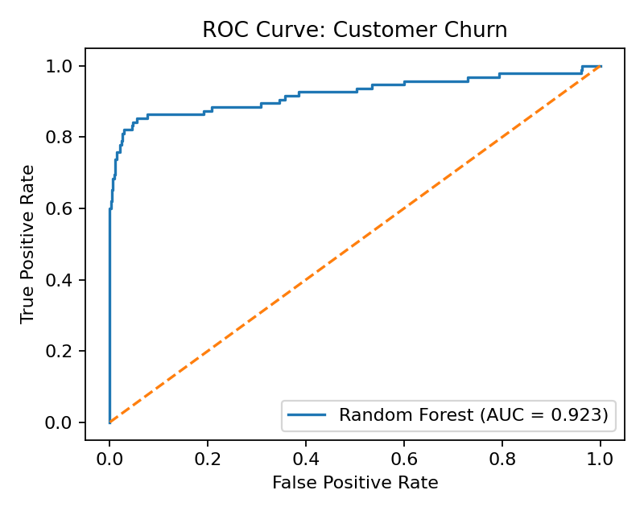
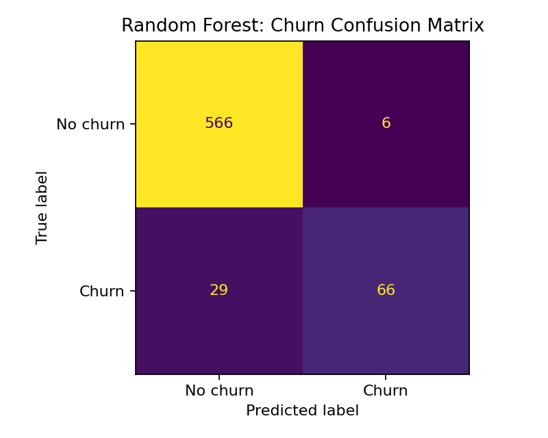
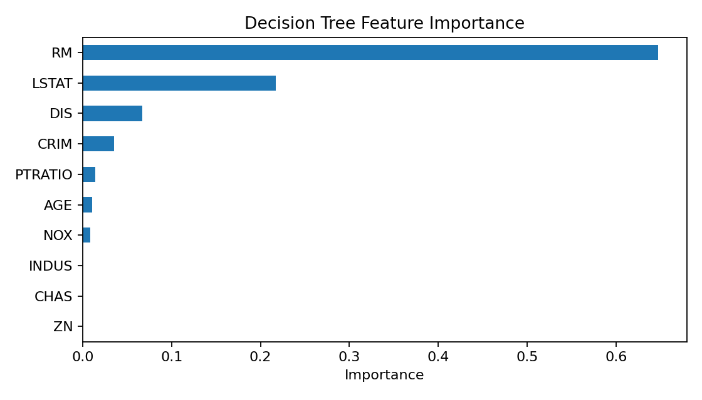

# Codveda Data Science Task Portfolio

## Scope
This portfolio implements six selected tasks from the supplied Codveda Data Science Task List, with the provided datasets.

### Selected tasks
- Level 1: Data Cleaning & Preprocessing; Exploratory Data Analysis (EDA)
- Level 2: Predictive Modeling (Regression); Classification
- Level 3: NLP Text Classification; Neural Networks

### Datasets used
- Telecom churn: 3,333 rows total (2,666 train; 667 test), 20 source features plus split marker.
- Housing prediction: 506 rows and 14 columns; header names assigned to the conventional Boston Housing order.
- Social media sentiment: 732 text records, 191 normalized source emotion labels.
- Iris: 150 rows; 3 duplicate rows identified and removed in the processed copy. Not used for selected modeling tasks.

## Key results
- Housing regression: Decision Tree achieved R² = 0.885 and RMSE = 2.906; Random Forest achieved MAE = 2.077.
- Churn classification: Random Forest achieved accuracy = 94.75%, precision = 91.67%, recall = 69.47%, F1 = 79.04%, ROC-AUC = 0.923.
- NLP: Logistic Regression achieved accuracy = 78.23% and macro F1 = 0.687.
- Neural network: MLP achieved accuracy = 90.55%, F1 = 67.36%, and ROC-AUC = 0.888.

## Results at a glance




## EDA findings
- Overall churn rate: 14.49%.
- Churn rate for customers with an international plan: 42.41%; without a plan: 11.50%.
- Churn rate among customers with 4+ customer-service calls: 51.69%; among those with 0–3 calls: 11.25%.
- Mean daily usage: churned customers 206.9 minutes; non-churned customers 175.2 minutes.

## Data quality
- Churn: 0 missing cells and 0 duplicate records. IQR outliers were flagged for review and retained where plausible.
- Sentiment: index-artifact columns removed; text whitespace normalized; timestamps parsed; emotion labels normalized.
- Housing: no header in source; conventional field names assigned by column order.
- Iris: 3 duplicate rows removed in processed copy.

## Important limitations
1. The sentiment source contains many emotion labels, not a native Positive/Negative/Neutral target. The three-class polarity label is a documented heuristic grouping. Results should be described as derived-label text classification.
2. The housing data is the historical Boston Housing benchmark and is not appropriate for current property pricing. The race-derived `B` feature was excluded from modeling.
3. The churn dataset is imbalanced. Report F1, recall, and ROC-AUC alongside accuracy.
4. Web scraping, clustering, and time-series forecasting were not selected because the brief requires only two tasks per level and the supplied datasets more directly support the selected tasks.

## Reproducibility
```
pip install -r requirements.txt
```
Open `notebooks/Codveda_Data_Science_Tasks.ipynb` in Jupyter and run cells from top to bottom.

Notebook status: Notebook contains the reproducible Keras implementation; Keras metrics were executed and documented in the report. Re-run the notebook in an environment with TensorFlow/Keras or Keras 3 + PyTorch.
